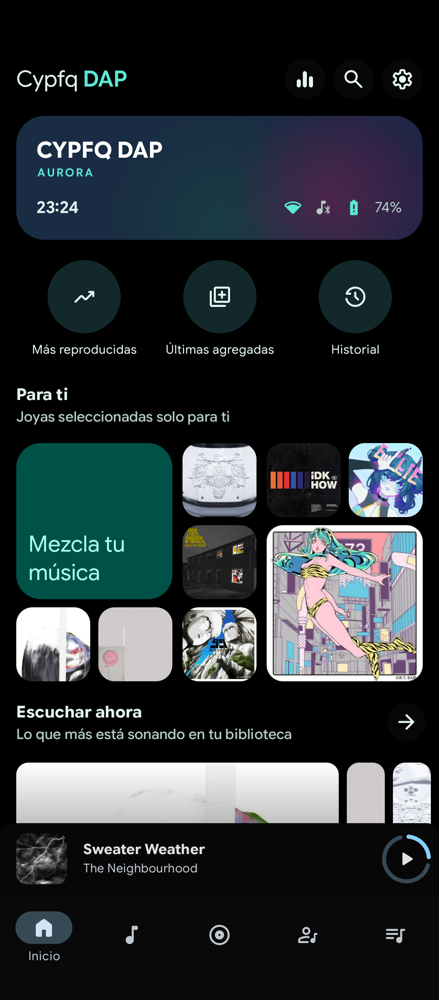
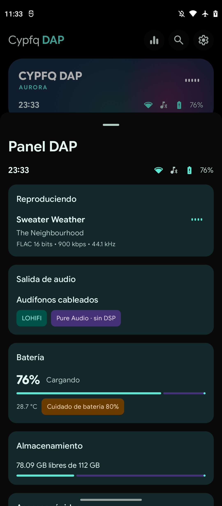
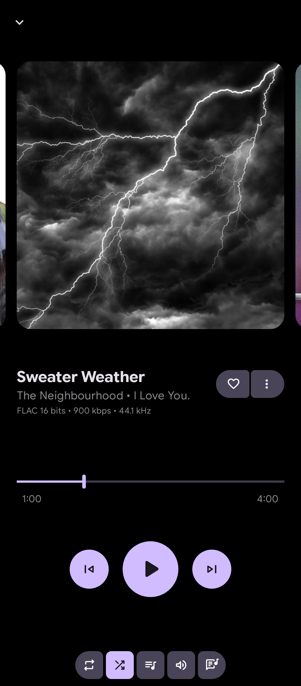

# Elyvaen

Elyvaen es una distribución Android basada en stock para convertir el Moto G51 5G en un DAP de alta fidelidad, con kernel propio y control total del sistema.

Sistema operativo tipo *appliance* para el **Motorola Moto G51 5G (cypfq)**, construido sobre la ROM stock de Motorola y orientado a convertirlo en un reproductor de audio (DAP) de alta calidad.

No es una ROM basada en crDroid, LineageOS ni PixelOS. La base es el firmware stock `cypfq_g` Android 12 respaldado desde el propio dispositivo, y los cambios se integran en las imágenes `system`, `system_ext`, `product` y `vendor`.

## Estado

- Base stock `S2RYA32.58-13-12-5-1-3`, Android 12, slot A.
- Bootloader desbloqueado, Magisk 30.7 y `vbmeta` con verificación desactivada.
- `super` A/B validado y arrancando, con audio de vendor integrado.
- App Elyvaen DAP (BoomingMusic personalizado) y teclado HeliBoard integrados.
- `super` Elyvaen v0.1 generado y validado (2.1 GB sparse); pendiente integrar módulos del kernel y flash final.
- Kernel 5.4.259 compilado y probado en `boot_a`: arranca y el display funciona. Táctil/audio propios pendientes de los módulos vendor del mismo kernel.

## Galería

| Home | Panel DAP | Reproductor |
|---|---|---|
|  |  |  |

## Nota de marca

Las capturas muestran la app DAP actual, que todavía conserva el nombre "Cypfq DAP" en la interfaz. La próxima compilación la rebautizará como **Elyvaen DAP**.

## Objetivo

- Audio 24/192, Pure Audio, LOHIFI, sin DSP ni altavoz.
- Interfaz DAP propia (BoomingMusic + Panel DAP) como pantalla de inicio.
- Arranque directo al reproductor, kiosco, 120 Hz, gobernador `schedutil`.
- Carga limitada al 80 %, DND total y volumen seguro desactivado.
- Control root y capacidad de seguir modificando el sistema.
- A medio plazo: kernel propio desde las fuentes oficiales de Motorola con UAC2.

## Estructura

```
config/                 Lista de debloat seguro y propiedades de build
docs/                   Estado del dispositivo, investigación, build, recuperación y roadmap
magisk/                 Módulos Magisk actuales, como referencia y respaldo
payload/                Árbol de archivos que se integra en las imágenes
  product/              Apps priv-app/app, permisos, bootanimation
  system/               Init script, rc y keylayout
  vendor/               Política de audio, mixer y efectos
scripts/                Build, verificación, flash, restauración y descarga de fuentes
third_party/            Material de terceros (BoomingMusic)
```

## Build rápido

Requisitos en Alpine Linux:

```sh
apk add android-tools android-tools-lpdump android-tools-lpmake \
    android-tools-lpunpack android-tools-simg2img android-tools-avbtool \
    e2fsprogs e2fsprogs-extra e2tools git python3 wget
```

Construir imágenes y `super`:

```sh
cd /workspace/Android/Elyvaen
BACKUP_DIR=/workspace/Android/cypfq_backup ./scripts/build-super.sh all
```

Salida:

```
build/super.sparse.img      Imagen sparse para fastboot
build/super.raw.img         Imagen raw de 13.7 GB con metadata A/B original
build/images.sha256         Hashes de las imágenes modificadas
build/manifest.txt          Resumen del build
```

Ver [docs/build.md](docs/build.md) para el detalle.

## Reglas de seguridad

- **crDroid está prohibido en este proyecto.** No se usan sus recovery, `dtbo`, `vendor_boot`, kernel ni device trees.
- No mezclar imágenes de recovery de otra ROM con la ROM stock: eso fue lo que rompió el táctil anteriormente.
- Antes de flashear, comprobar batería > 50 % y tener los backups de `super`, `boot_a`, `dtbo_a` y `vendor_boot_a`.
- El rollback conocido-bueno es `cypfq_backup/super_ab_safe.img`.
- No se toca `bootloader`, `gpt`, `modem`, `persist`, `frp` ni las particiones de calibración.

## Estado técnico

- Base stock Android 12, slot A; TWRP vive en `boot_b` y no se toca.
- Kernel propio 5.4.259 (`nokernelsu`) compilado con techpack Motorola completo.
- Primer test de kernel: `boot_a` con ramdisk stock, display y arranque OK; táctil/audio requieren los módulos del kernel nuevo.
- Backups completos en `cypfq_backup/` y rollback documentado en [docs/recovery.md](docs/recovery.md).

## Fuentes oficiales

- Firmware stock: `cypfq_backup/firmware/attmx_full.zip` (`S2RYAS32.58-13-12-5-1-4`).
- Kernel Motorola oficial: tag `MMI-S2RYA32.58-13-12-5-9` en `MotorolaMobilityLLC/kernel-msm` y sus repositorios compañeros (`kernel-msm-5.4-techpack-*`, `kernel-devicetree`, `motorola-kernel-modules`).
- Kernel alternativo recomendado para UAC2: `Mxiier/kernel_motorola_cypfq`, rama `nokernelsu` (Linux 5.4.259, techpack completo, sin KernelSU).
- Detalle completo en [docs/research.md](docs/research.md), [docs/kernel.md](docs/kernel.md) y [docs/device.md](docs/device.md).

## Contribuir

Lee [CONTRIBUTING.md](CONTRIBUTING.md). La regla principal: base stock, nada de crDroid, y nunca tocar `boot_b`/TWRP.

## Licencia

GPL-3.0-or-later para el código y scripts de este repositorio. BoomingMusic es GPL-3.0. El firmware stock y los blobs propietarios de Motorola/Qualcomm no se distribuyen aquí.
